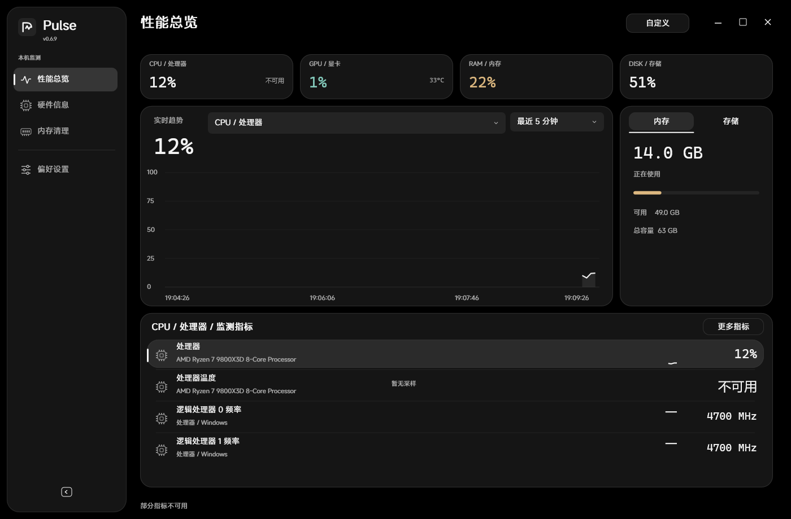
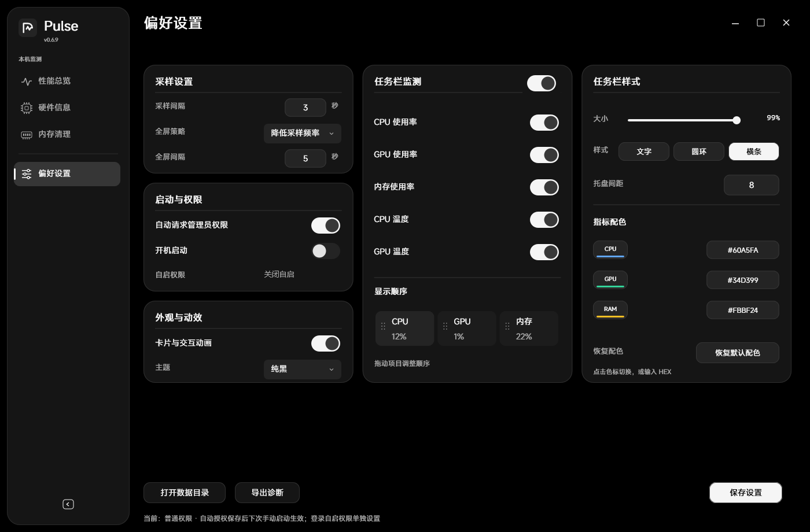

# Pulse

轻量的 Windows 硬件实时监测工具，让系统状态一眼可见。

## 下载

当前版本：**v0.6.9**，适用于 **Windows 10 / 11 x64**。

- [下载安装包](https://github.com/Qianfna/Pulse/releases/latest/download/Pulse-v0.6.9-Setup-x64.exe)
- [下载免安装 ZIP](https://github.com/Qianfna/Pulse/releases/latest/download/Pulse-v0.6.9-Windows-x64.zip)
- [版本与更新记录](https://github.com/Qianfna/Pulse/releases)
- [访问官网](https://pulsemon.pages.dev/)

安装版按向导操作即可；免安装版请完整解压后运行 `Pulse.exe`，保留同目录的 `sensors` 和脚本。

## 功能

- CPU、GPU、内存、磁盘和网络实时监测，配合硬件详情查看系统状态。
- 自定义监测卡片，支持添加、排序、拖动和调整大小。
- 实时曲线在内存中保留最近 30 分钟数据，退出后释放。
- 任务栏监测，支持文字、圆环、横条及配色调整。
- 两种暗色主题、减少动画选项，以及独立的启动与权限设置。

## 使用提示

CPU 温度等指标取决于硬件、驱动与运行权限；无法读取的指标会如实显示。管理员权限通过 Windows UAC 由使用者确认。

v0.6.9 新增“自动请求管理员权限”选项，并修复部分开机启动任务无法关闭的问题。具体更新见 [v0.6.9](https://github.com/Qianfna/Pulse/releases/tag/v0.6.9)。
